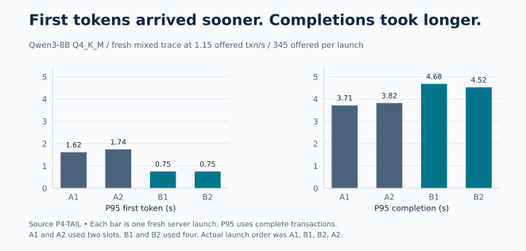

# Inference Audit

**Find out how much useful work your LLM server can deliver.**

Inference Audit is a local-first CLI for self-hosted inference. It sends bounded, synthetic traffic to an authorized OpenAI-compatible endpoint and measures how quickly responses arrive, how many pass their task checks, and how many meet your deadlines. Rebuild a shareable HTML report offline from the saved observations.

[Project site](https://somsom786.github.io/inference-audit/) · [Interactive case study](https://somsom786.github.io/inference-audit/case-study.html) · [Sample audits](https://somsom786.github.io/inference-audit/samples.html) · [Public preview v0.2.1](https://github.com/somsom786/inference-audit/releases/tag/v0.2.1)

## What changed when we added serving slots?

On an RTX 4070, four serving slots improved Qwen3-8B chat-burst throughput by **57.7%** over a two-slot production control. A separate, fresh mixed-workload test found faster first tokens on four slots, slower completions, and fewer correct on-time transactions per second. Neither profile met the 95% target in every workload family. [Burst evidence](docs/publication/CLAIMS_LEDGER.md#p2-chat) · [Mixed-workload evidence](docs/publication/CLAIMS_LEDGER.md#p4-goodput) · [Family qualification](docs/publication/CLAIMS_LEDGER.md#p4-family)

[](https://somsom786.github.io/inference-audit/case-study.html#experiment)

## Quick start

Use Python 3.14 on Windows for the verified pilot setup. From a checkout of the public release, set the model ID and approved workload limits in [`configs/local.yaml`](configs/local.yaml). Benchmark traffic consumes real inference capacity.

```powershell
python -m venv .venv
.\.venv\Scripts\python.exe -m pip install .
.\.venv\Scripts\inference-audit.exe inspect --url http://127.0.0.1:8080
.\.venv\Scripts\inference-audit.exe benchmark --config configs/local.yaml --run first-local --approve-load
.\.venv\Scripts\inference-audit.exe verify --run first-local
.\.venv\Scripts\inference-audit.exe report --run first-local
```

Open `runs/first-local/report/audit.html`. On Linux, the corresponding executables are `.venv/bin/python` and `.venv/bin/inference-audit`. The [staging config](configs/staging.example.yaml) covers a generic approved target. A hosted Windows Python 3.12 run exposed an open-loop timing issue in v0.2.1. Run a bounded smoke test and verify captures before collecting pilot evidence. [Known issues](docs/KNOWN_ISSUES.md)

## Read an audit

- **Speed.** First-token and completion latency, plus output rate from available usage data.
- **Useful capacity.** Correct on-time transactions per second, with late, rejected and failed work kept in the offered population. Capacity is the highest passing point on the tested workload grid.
- **Evidence.** Saved observations, offline verification and report regeneration. With optional NVIDIA telemetry, the audit shows board-level memory, utilization, temperature, clocks and power.

The [Qwen load sweep](https://somsom786.github.io/inference-audit/reports/qwen3-8b-audit.html) and [Gemma compatibility audit](https://somsom786.github.io/inference-audit/reports/gemma4-12b-audit.html) are generated from real local captures. Copies in [`public/reports/`](public/reports/README.md) open offline. Read the [technical case study](docs/case-study/INFERENCE_OPTIMIZATION_CASE_STUDY.md) for the methods and the results that failed to transfer.

## Staging pilots

Discuss an authorized endpoint, a representative workload, and the service target you need to check. [Contact Rayn Hasan on LinkedIn](https://www.linkedin.com/in/rayn-hasan/)

## Operating scope

The public preview targets scoped, customer-approved staging audits. It requires explicit load approval and leaves the serving configuration unchanged. Local CUDA acceptance covers pinned llama.cpp on Windows. Native Linux CUDA and customer production infrastructure remain unverified. The separate owned-process experiment mode is outside the public pilot scope. Evidence verification validates saved observations and calculations. It cannot re-grade answers that were withheld.

[Methodology](docs/METHODOLOGY.md) · [Security model](docs/SECURITY.md) · [Pilot runbook](docs/PILOT_RUNBOOK.md) · [Validation](docs/VALIDATION.md) · [Development](docs/DEVELOPMENT.md) · [MIT license](LICENSE) · [Issues](https://github.com/somsom786/inference-audit/issues)
