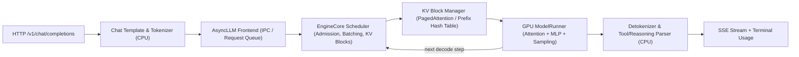

# vLLM Internals & Inference Performance Engineering Guide

> **Pinned Engine Reference:** `vLLM 0.34.0` (V1 engine architecture)  
> **Lab Grounding:** Local measurements cite our controlled RTX 4070 12 GB studies (Qwen3-8B Q4_K_M on vLLM 0.34.0 + `vllm-gguf-plugin` 0.0.5, Inkling-2-Mini 26B on `llama.cpp`, Forge Qwen3.5-9B on Ollama). Multi-GPU and datacenter topology sections explain architectural principles and vendor/vLLM documentation — **not** local H100/H200/B200 benchmarks.

---

## 1. End-to-End Request Lifecycle

Every OpenAI-compatible request passes through six distinct subsystems before the user sees a token. Treat **model, tokenizer/template, weights/quantization, engine/scheduler, hardware/topology, and workload** as independent variables and change only one at a time.

### Key vLLM 0.34.0 Source Paths
- **OpenAI Chat Serving & Template Rendering:** [`vllm/entrypoints/openai/chat_completion/serving.py`](https://github.com/vllm-project/vllm/blob/v0.34.0/vllm/entrypoints/openai/chat_completion/serving.py)
- **Async Frontend (Process Boundary):** [`vllm/v1/engine/async_llm.py`](https://github.com/vllm-project/vllm/blob/v0.34.0/vllm/v1/engine/async_llm.py)
- **EngineCore Loop:** [`vllm/v1/engine/core.py`](https://github.com/vllm-project/vllm/blob/v0.34.0/vllm/v1/engine/core.py)
- **V1 Unified Scheduler:** [`vllm/v1/core/sched/scheduler.py`](https://github.com/vllm-project/vllm/blob/v0.34.0/vllm/v1/core/sched/scheduler.py)
- **GPU Model Runner:** [`vllm/v1/worker/gpu/model_runner.py`](https://github.com/vllm-project/vllm/blob/v0.34.0/vllm/v1/worker/gpu/model_runner.py)

### Subtle Failure Modes Along the Path
1. **Tokenization & Chat Templates:** Adding a dynamic timestamp, user ID, or reordering JSON tool definitions at the start of the system message changes early token IDs and destroys prefix-cache hits. Similarly, `enable_thinking: true` emits reasoning tokens before visible answer tokens — so client `first_visible_content` diverges from engine `TTFT`.
2. **SSE Chunking vs Token Counts:** One HTTP SSE chunk can contain 0 tokens (role/metadata), 1 token, or multiple tokens (batch detokenization). Never count SSE chunks as output tokens; use verified terminal `usage.completion_tokens`.
3. **IPC & Output Processing:** V1 decouples the HTTP/tokenizer frontend from `EngineCore` in separate processes to keep Python HTTP overhead off the GPU scheduling critical path.

---

## 2. Prefill vs. Decode, Roofline Model & Memory Hierarchy

### Hardware Memory Hierarchy (Why Placement Matters)
From fastest/smallest to slowest/largest:
1. **SM Registers & Shared Memory (SRAM):** Tens of TB/s aggregate; holds active FlashAttention tiles (`Q`, `K`, `V` tiles) so intermediate attention matrices never materialize in HBM/VRAM.
2. **GPU L2 Cache:** Tens of MB; absorbs small repeated metadata and active expert weights.
3. **GPU VRAM (GDDR6X / HBM3 / HBM3e):** RTX 4070 GDDR6X delivers ~504 GB/s theoretical (`431 GB/s` measured native copy bandwidth in our lab); H100 SXM delivers ~3.35 TB/s; H200 ~4.8 TB/s; B200 ~8 TB/s.
4. **Host System RAM over PCIe:** PCIe Gen4 x16 peaks around ~25–28 GB/s usable (~15–20× slower than RTX 4070 VRAM, >100× slower than HBM3). Any weight or KV tensor spilled across PCIe dominates step latency.

### Arithmetic Intensity & Roofline Equations
Let $W_{\text{bytes}}$ be active model weight bytes read per forward step, $B_{\text{eff}}$ effective GPU memory bandwidth (bytes/s), $F_{\text{peak}}$ effective tensor-core compute (FLOPs/s), and $N_{\text{tok}}$ total tokens processed in a step:

$$\text{Arithmetic Intensity (FLOPs/byte)} \approx \frac{2 \cdot P_{\text{active}} \cdot N_{\text{tok}}}{W_{\text{bytes}} + \text{KV}_{\text{bytes}}}$$

- **Prefill (Compute-Bound at Long Prompts):** Processes $N_{\text{tok}} \gg 1$ prompt tokens simultaneously. Weights are loaded once and reused across all prompt tokens, pushing arithmetic intensity above the GPU's ridge point ($F_{\text{peak}} / B_{\text{eff}}$). Dense causal attention also scales $O(L^2)$ in prompt length $L$.
- **Decode (Memory-Bandwidth-Bound at Small Batches):** Each active sequence advances by 1 token ($N_{\text{tok}} = B_{\text{batch}}$). At $B_{\text{batch}} = 1$, the GPU streams all active weights to produce a single token.

#### Worked Example — RTX 4070 Short-Context Decode Proxy
- Measured native RTX 4070 copy bandwidth: $B_{\text{eff}} \approx 431\text{ GB/s}$
- Approximate Qwen3-8B Q4_K_M active weight scan: $W_{\text{bytes}} \approx 4.6718\text{ GB}$
- Upper-bound single-stream short-context proxy:
  $$\text{tok/s}_{\text{proxy}} = \frac{431\text{ GB/s}}{4.6718\text{ GB}} \approx 92.3\text{ tok/s}$$
- **What we actually measured in our lab:**
  - Native Windows `llama.cpp` b12427 (`c=1`): **78.28 tok/s** (~85% of the raw copy proxy — classic well-tuned bandwidth-bound decode).
  - WSL2 vLLM `0.34.0` + experimental `vllm-gguf-plugin` `0.0.5` (`--enforce-eager`, static KV, `c=1`): **30.12 tok/s** (client-visible post-first-token proxy `32.66 tok/s`). Why the gap? Eager Python launch overhead, experimental GGUF dequantization kernels, and WSL2/FlashInfer fallbacks meant `c=1` was **launch/kernel-overhead bound**, not VRAM-bandwidth bound — which is also why scaling to `c=4` nearly tripled vLLM aggregate throughput (`30.12 → 98.36 tok/s`, 3.27×) as batching amortized per-step overhead!

---

## 3. PagedAttention & KV-Cache Block Math

Traditional serving allocated one contiguous VRAM buffer of size `max_model_len` per request, wasting 60–80% of KV memory on internal fragmentation. **PagedAttention** splits each sequence's KV cache into fixed-size **physical blocks** (typically `block_size = 16` tokens) indexed by a logical-to-physical block table.

### Exact KV-Cache Memory Formula (GQA / MHA)
$$\text{KV bytes/token} = 2 \times n_{\text{layers}} \times n_{\text{kv\_heads}} \times d_{\text{head}} \times b_{\text{dtype}}$$

*(Factor of `2` is for K and V. Hybrid/recurrent/MLA models like DeepSeek MLA or Mamba/DeltaNet require architecture-specific state formulas.)*

#### Worked Example — Qwen3-8B (FP16 KV Cache)
- $n_{\text{layers}} = 36$, $n_{\text{kv\_heads}} = 8$ (GQA), $d_{\text{head}} = 128$, $b_{\text{dtype}} = 2$ bytes (FP16):
  $$\text{KV bytes/token} = 2 \times 36 \times 8 \times 128 \times 2 = 147,456\text{ bytes/token } (144\text{ KiB/token})$$
- **1 sequence at 1,536 tokens:** $1,536 \times 144\text{ KiB} = \mathbf{216\text{ MiB}}$
- **1 sequence at 4,096 tokens:** $4,096 \times 144\text{ KiB} = \mathbf{576\text{ MiB}}$
- **4 concurrent sequences at 4,096 tokens:** $4 \times 576\text{ MiB} = \mathbf{2.25\text{ GiB}}$ (payload only, before weights, CUDA graph pools, activations, and allocator fragmentation).

#### Real Lab Failure Mode (Phase 9 RTX 4070 Startup Envelope)
At `--gpu-memory-utilization 0.67` (~8.0 GiB budget on 12 GB RTX 4070):
- Weights + runtime overhead consumed ~7.5 GiB.
- Default CUDA graphs + extensible KV at 4,096 context left only ~0.24 GiB for KV when 0.56 GiB was needed → **startup OOM**.
- Even eager + extensible KV at 1,280 context failed post-warmup (`0.47 GiB` transient reservation reduced usable blocks to 0).
- Switching to `--enforce-eager --no-enable-extensible-kv-cache` at 1,280 context freed **1,536 KV tokens** (`216 MiB`, `1.20×` full-context concurrency), allowing the server to boot cleanly.

---

## 4. Scheduler Internals, Continuous Batching & Chunked Prefill

In vLLM V1, **continuous batching** and **chunked prefill** are unified into a single token-budgeted scheduler (`--max-num-batched-tokens` and `--max-num-seqs`):
- Every scheduler iteration allocates a budget of `max_num_batched_tokens` across active decode tokens (1 token per running sequence) and remaining prefill chunks.
- **Why chunked prefill matters:** Without chunking, a single 8,192-token prompt blocks all active decode users for seconds, spiking p95/p99 ITL. Chunking slices the 8K prompt across multiple steps so decode users keep receiving tokens.
- **The hidden trade-off (verified in our Phase 9 RTX 4070 bracket):**
  - Lowering `--max-num-batched-tokens` from default to **512** reduced activation workspace and freed KV capacity from **1,536 → 2,752 tokens** (+79% KV tokens!).
  - Yet at 4 closed-loop workers, aggregate throughput **dropped** from `98.36` / `93.69` tok/s (controls) to **`90.71` tok/s**, and correct on-time goodput fell from `1.100` / `1.035` to **`0.940` tasks/s**.
  - **Lesson:** Shrinking the token budget protects decode cadence under heavy long-prompt interference, but if the workload is not prefill-interference bound, smaller chunks add extra forward passes and hurt total throughput. Always run an `A-B-A` control bracket!

---

## 5. Automatic Prefix Caching (APC)

PagedAttention enables zero-copy sharing of physical KV blocks across requests that share an identical token prefix:
- Each completed full block (e.g., 16 tokens) is hashed using `(parent_block_hash, block_token_ids, cache_salt/LoRA/MM_metadata)`.
- On a cache hit, the scheduler maps the new request's logical blocks directly to the existing physical blocks and skips prefill compute for those tokens.
- **Eviction:** Unreferenced cached blocks sit in an LRU eviction queue and are reclaimed only when new requests need physical blocks. High KV pressure causes **cache thrashing** (blocks evicted before reuse).
- **Partial tail blocks:** Only *complete* blocks are hashed and shared; trailing tokens beyond the last full block boundary are always recomputed.

### Real Lab Evidence (Phase 9 RTX 4070 Prefix Probe)
Across 3 fresh vLLM launches (54/54 exact receipts, 6 independent ~1,132-token prefixes):
- **Cold TTFT (median):** `2.768–2.778 s`
- **Warm cached TTFT (median):** `0.122–0.125 s` (**~22× reduction** in TTFT)
- **Early-prefix-changed negative control (median):** `2.764–2.772 s` (proving genuine block-hash prefix reuse, not warm-GPU luck)
- **Important nuance:** A 22× TTFT improvement on a repeated prefix does **not** mean 22× end-to-end throughput — decode time is unchanged, and only prompts with stable leading prefixes benefit.

---

## 6. Preemption & Recomputation

When all physical KV blocks are full and a running sequence needs another block for its next decode token, the scheduler must **preempt** a lower-priority (typically most-recently-admitted) running sequence:
- **Recomputation (default in V1):** Evicts the victim sequence's KV blocks back to the free pool and re-queues it into `waiting`. When admitted again, its prompt + already-generated tokens are re-prefilled as a single prompt.
- **Cost:** Preemption converts cheap decode work into expensive prefill work, spikes tail latency dramatically, and wastes GPU compute.
- **How to detect:** Monitor `vllm:kv_cache_usage_perc` approaching `>= 0.90` together with positive deltas on `vllm:num_preemptions_total` on the **same label series**.

---

## 7. Execution Backends: CUDA Graphs, Attention Kernels, Quantization & Speculation

### CUDA Graphs
- Small-batch decode launches hundreds of tiny CUDA kernels per token; Python/CPU launch latency can exceed GPU kernel execution time.
- CUDA graphs record a static kernel DAG for discrete batch sizes (e.g., `1, 2, 4, 8, 16, 32`) and replay it with a single host launch.
- **Trade-off:** Graph capture reserves non-reclaimable VRAM (often 0.3–1.5 GiB depending on model/shapes). `--enforce-eager` disables graphs for debugging or tight VRAM, at the cost of higher per-step host overhead.

### Attention Kernels
- vLLM selects attention backends (FlashAttention-2/3, FlashInfer, Triton, MLA kernels) based on GPU compute capability, head dimension, KV dtype, and quantization.
- Always check startup logs for silent fallbacks (e.g., FlashInfer fallback or disabled pinned host memory, both observed in our WSL2 RTX 4070 run).

### Quantization
- **Weight-only (AWQ, GPTQ, W4A16, GGUF):** Shrinks weight bytes read during memory-bound decode, raising decode tok/s — **provided** fused dequantization kernels exist for that GPU/batch size. Experimental or unfused kernels (like GGUF in `vllm-gguf-plugin`) can lose bandwidth gains to dequantization overhead.
- **W8A8 (FP8 on Ada/Hopper/Blackwell, INT8):** Accelerates *both* compute-bound prefill (via FP8 tensor cores) and memory-bound decode.
- **KV-cache quantization (FP8 KV):** Halves KV bytes/token (doubling concurrent sequence capacity) at the risk of subtle long-context or tool-call accuracy loss — **must** be re-qualified on task correctness!

### Speculative Decoding (MTP / Draft Models / N-gram)
If a draft mechanism proposes $k$ tokens and the target verifies them in one parallel forward pass, yielding $a \in [1, k+1]$ accepted tokens on average:

$$t_{\text{per\_emitted\_token}} \approx \frac{t_{\text{draft}}(k) + t_{\text{verify}}(k+1)}{a}$$

- Speedup occurs **only** when $t_{\text{draft}} + t_{\text{verify}}$ grows slower than $a$.
- **Why it breaks under concurrency:** At high batch sizes, verification becomes compute-bound (`batch × (k+1)` tokens), erasing the free bandwidth headroom that made single-stream speculation fast.
- **Real Lab Evidence (Forge Qwen3.5-9B MTP on RTX 4070):** `k=1` single-stream lifted structured Python by **+23.5%** and 4K code by **+16.5%** (19/19 exact matches), whereas `k≥2` regressed and **`concurrency=2` failed to beat controls while consuming +522 MiB VRAM**.

---

## 8. Multi-GPU Topologies & Disaggregated Serving *(Architectural Concepts — Not Tested on RTX 4070)*

| Topology | How It Splits Work | Primary Benefit | Primary Bottleneck / Risk |
| :--- | :--- | :--- | :--- |
| **Tensor Parallelism (TP)** | Shards attention heads & MLP matrices across GPUs | Fits large weights & reduces single-request decode latency | All-reduce collectives every layer; requires NVLink/NVSwitch (PCIe degrades severely at small batches) |
| **Pipeline Parallelism (PP)** | Assigns contiguous layer ranges to different GPUs | Fits models across nodes with low inter-node bandwidth | Pipeline bubbles; does not cut single-request latency |
| **Expert Parallelism (EP)** | Distributes MoE experts across GPUs | Scales sparse MoE parameters cleanly | All-to-all token dispatch & skewed expert routing stragglers |
| **Data Parallelism (DP)** | Independent full replicas behind a router | Linear aggregate throughput scaling | Splits prefix cache across replicas unless prefix-aware routing is used |
| **Disaggregated P/D** | Dedicated prefill pool + dedicated decode pool transferring KV | Eliminates prefill-to-decode ITL interference; independent scaling | KV-transfer fabric latency/bandwidth, connector backpressure, failure recovery |

---

## 9. Prometheus Observability & Honest Attribution

Key vLLM Prometheus metrics (`vllm:*`):
- **Gauges (instantaneous state):** `num_requests_running`, `num_requests_waiting`, `kv_cache_usage_perc` (legacy alias `gpu_cache_usage_perc`). *Risk:* 5-second scraping can miss sub-second spikes.
- **Counters (monotonic cumulative):** `num_preemptions_total`, `prompt_tokens_total`, `generation_tokens_total`, `prefix_cache_queries_total`, `prefix_cache_hits_total`. *Rules:* Compute deltas only across consecutive valid scrapes within the same stage and same label series; skip decreases (counter resets) and missing scrapes; never impute zero for unobserved intervals.
- **Histograms (`*_bucket`):** `request_queue_time_seconds`, `request_prefill_time_seconds`, `request_decode_time_seconds`, `e2e_request_latency_seconds`, `time_to_first_token_seconds`, `inter_token_latency_seconds`, `request_time_per_output_token_seconds`. *Rules:* Report exact bucket intervals (`[low_s, high_s]`), withhold p95 below 40 observations, never merge incompatible bucket schemas or distinct replica label series.

---

## 10. Inference Economics Formula

Let **goodput** $G$ be **correct, on-time transactions per second** under the customer's exact SLO and quality contract. Improving qualified goodput by factor $g = G_{\text{new}} / G_{\text{old}} > 1$ at fixed demand reduces required scalable GPU-hours by:

$$\text{GPU-hour reduction} = 1 - \frac{1}{g}$$

- Example: $g = 1.30$ (+30% qualified goodput) → $1 - 1/1.30 = \mathbf{23.1\%}$ fewer GPU-hours. On `$50,000/month` (`$600,000/year`) of **fully reducible scalable GPU spend**, that corresponds illustratively to `~$138,462/year`.
- **Real-world friction:** Reserved instances, integer node counts (you cannot rent 0.7 of an 8×H100 node), N+1 failover capacity, and low off-peak utilization shrink realizable savings.

---

## 11. Twenty Technical Questions (CTO & Infra Engineer Drills)

1. **Why can raising batch size increase output tok/s while making user experience worse?**
   Weight reuse raises aggregate throughput, but each decode step reads more KV cache and takes longer (higher ITL), and requests may wait longer in queue (higher TTFT). Always evaluate **qualified goodput** under per-family deadlines, not raw tok/s.
2. **How do you calculate the single-stream decode speed ceiling of a GPU?**
   Divide measured effective VRAM bandwidth by active bytes scanned per token (`weights + KV`). On our RTX 4070 (`431 GB/s / 4.67 GB`), Qwen3-8B Q4_K_M has a ~92.3 tok/s short-context proxy; falling far below it points to launch overhead, unfused kernels, or CPU bottlenecks.
3. **Why did Qwen3-8B Q4_K_M on RTX 4070 fail to boot with default vLLM settings at 4K context?**
   At 0.67 GPU budget (~8.0 GiB), model weights + runtime took ~7.5 GiB, leaving only ~0.24 GiB for KV when 4K FP16 KV needed 576 MiB (`0.56 GiB`) plus CUDA graph capture and transient warmup buffers.
4. **How does GQA reduce memory pressure, and what does it NOT reduce?**
   GQA shares K/V heads across multiple query heads (e.g., 8 KV heads vs 32 Q heads in Qwen3-8B), shrinking KV cache size and KV read bandwidth by 4×. It does not shrink MLP/attention weight reads or Q projection compute.
5. **What is the exact difference between TTFT, ITL, TPOT, and E2E latency?**
   TTFT is request arrival to first token; ITL is inter-token interval between consecutive generated tokens; TPOT is `(E2E - TTFT) / (output_tokens - 1)`; E2E is full completion time. Client SSE chunks do not map 1:1 to engine ITL events.
6. **Why did shrinking `--max-num-batched-tokens` to 512 free KV cache yet hurt c4 throughput in our Phase 9 bracket?**
   Smaller token budgets shrink temporary activation/prefill buffers, freeing more VRAM for KV blocks (`1,536 → 2,752`). However, without heavy long-prompt interference, capping tokens per step forced extra forward passes and reduced batch efficiency (`98.36 → 90.71 tok/s`).
7. **How do you prove a TTFT drop came from prefix caching rather than warm-GPU or OS page-cache effects?**
   Run a 3-arm triplet on fresh launches: (1) cold prefix, (2) identical prefix with new suffix, (3) **early-prefix-changed negative control** of identical length. True APC drops arm 2 (e.g., `2.78 s → 0.125 s`) while arm 3 returns to cold (`2.77 s`) and `prefix_cache_hits_total` climbs.
8. **Why can prefix caching fail in production even when `--enable-prefix-caching` is enabled?**
   Dynamic tokens (timestamps, request IDs) placed at the start of prompts break block hashes; round-robin load balancers scatter identical prefixes across replicas; or KV saturation evicts cached blocks before reuse.
9. **What happens inside vLLM when KV cache reaches 100% mid-generation?**
   The scheduler preempts a running sequence, freeing its physical KV blocks and returning it to `waiting`. On re-admission, vLLM recomputes the entire prefix + generated tokens so far, spiking tail latency and wasting prefill FLOPs.
10. **Why can a waiting queue build up when `nvidia-smi` GPU utilization is only 25%?**
    Either CPU tokenization/detokenization/scheduling or eager Python launch overhead is starving the GPU, OR KV-cache memory is full so only a tiny batch can run, OR coarse 1.5s `nvidia-smi` sampling is missing short bursts. Profile with PyTorch/Nsight timelines before guessing.
11. **When does speculative decoding (MTP or draft model) become counterproductive?**
    When acceptance rate is low (creative prose vs structured code), when draft depth `k` is too high (wasted draft/verify FLOPs), or under concurrency where batched verification turns compute-bound (as proved in our Forge Qwen3.5-9B `c=2` study).
12. **Why can a 4-bit GGUF model run slower in vLLM than in `llama.cpp` on the same GPU?**
    Quantization speed depends on fused kernels, memory layout, and runtime overhead. Experimental GGUF dequantization in vLLM + eager mode + WSL2 overhead ran at `30.12 tok/s` (`c=1`) vs `78.28 tok/s` in native `llama.cpp` — a runtime/kernel difference, not a universal engine ranking.
13. **Why did our Inkling-2-Mini loop-aware placement beat `llama.cpp` auto-fit by +37.8% decode and +55.2% 8K prefill?**
    Inkling loops 12 middle blocks (`blk.6..17`) 3× per token — concentrating 72.3% of active expert reads in 6.88 GB. Pinning those hot looped blocks in VRAM delivered 3× more PCIe bandwidth savings per GiB than naive sequential layer placement.
14. **When should you choose Tensor Parallelism (TP) vs Data Parallelism (DP)?**
    Use DP first whenever the model + required KV cache fits on 1 GPU (zero cross-GPU collective overhead, linear throughput scaling). Use TP when the model does not fit on 1 GPU or when single-request latency requires splitting weight reads across NVLink-connected GPUs.
15. **What makes Expert Parallelism (EP) tricky on MoE models?**
    Token routing is often skewed toward a few hot experts, creating load imbalance where all GPUs stall waiting for the slowest rank's all-to-all exchange and GEMM.
16. **When does Prefill/Decode disaggregation actually pay off?**
    When mixed long-prompt prefill severely degrades decode ITL, prefill and decode have very different hardware ratios, and the KV-transfer fabric (NVLink/RDMA) moves KV state faster than the queuing/interference delay it eliminates.
17. **Why should you never merge Prometheus counters or histograms across different label series?**
    Distinct label series represent different replicas, engines, or models. Summing cumulative histograms across mismatched bucket schemas or mixed replicas produces mathematically invalid quantiles and hides single-replica saturation.
18. **How do you handle a counter reset or missing Prometheus scrape in an audit report?**
    Detect negative deltas (`b < a`) as resets and non-consecutive indices as gaps; exclude those intervals from cumulative deltas and explicitly report `detected_resets` and `gaps` — never invent zero or extrapolate missing traffic.
19. **Why must errors, timeouts, and quality failures stay in the goodput denominator?**
    Dropping HTTP 400s, context rejections, or broken tool calls from the denominator inflates apparent speed and hides broken configurations (as seen in our Qwen3-8B mixed-load study where +57.7% burst tok/s *lost* correct on-time tasks/s).
20. **How do you defend an inference cost-savings estimate to a skeptical CFO or CTO?**
    Anchor on **qualified goodput** under real SLOs, apply $1 - 1/g$ only to **reducible** GPU spend, explicitly subtract fixed/reserved/N+1 failover constraints, and present it as a conditional scenario until validated on their staging workload.

---

## 12. Hands-On Local Exercises (Using Existing RTX 4070 Setup)

1. **KV Capacity Verification:** Compute Qwen3-8B FP16 KV bytes for 1,280 and 4,096 tokens (`147,456 B/tok`). Start `scripts/vllm_local.sh serve --enforce-eager --no-enable-extensible-kv-cache` and verify the logged KV block count matches `1,536` tokens (`96` blocks × `16` tokens/block).
2. **Controlled Prefix-Cache Triplet:** Run `scripts/probe_vllm_prefix.py` against the local endpoint and confirm cold TTFT (~2.77s), warm TTFT (~0.125s), early-prefix-changed control (~2.77s), and positive `vllm:prefix_cache_hits_total` delta.
3. **Closed-Loop Scaling Curve:** Run `configs/vllm.local.yaml` (or inspect `public/evidence/vllm-phase9.json`) at `c=1, 2, 4` and plot output tok/s vs TTFT p50 to see overhead amortization vs queue onset.
4. **Offline Evidence Verification & Tamper Detection:** Run `inference-audit verify --run <run>` on a sealed bundle, then modify one byte in `server.jsonl` on a *copy* of the run and verify that `inference-audit verify` rejects the tampered SHA-256 digest.
5. **Synthetic Observability Edge-Case Drill:** Run `pytest tests/test_vllm_metrics.py -v` and inspect how counter resets, trailing schema changes, missing `le` labels, and `transport_failure` scrapes are surfaced without fabricating zeros.
