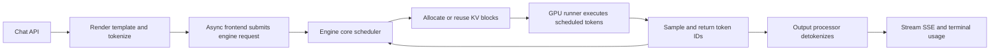

# vLLM internals and inference performance

Work through one model and one replayable trace first. Treat the model, tokenizer, weights, template, engine, GPU and load as six independent inputs. Change one at a time. The source references below are pinned to vLLM 0.34.0, the release selected for the Phase 9 lab. Engine interface names in an older guide may describe a different runner.

## 1. Follow one request

The chat route validates options and uses the model's template. A tool schema, system message or thinking option changes token IDs and can destroy prefix hits. The async frontend prepares requests and streams output while the engine core batches across independent sessions. The scheduler gives requests token increments within budget, including prefill and decode work in the same step. A worker prepares tensors and runs the selected attention and quantization kernels. The output processor detokenizes and formats results. The order of upstream events need not match when your client sees the first visible content, especially with reasoning or tool deltas.

Read the [chat serving path](https://github.com/vllm-project/vllm/blob/v0.34.0/vllm/entrypoints/openai/chat_completion/serving.py), [async frontend](https://github.com/vllm-project/vllm/blob/v0.34.0/vllm/v1/engine/async_llm.py), [EngineCore](https://github.com/vllm-project/vllm/blob/v0.34.0/vllm/v1/engine/core.py), [scheduler](https://github.com/vllm-project/vllm/blob/v0.34.0/vllm/v1/core/sched/scheduler.py), [V2 GPU model runner](https://github.com/vllm-project/vllm/blob/v0.34.0/vllm/v1/worker/gpu/model_runner.py) and [architecture overview](https://docs.vllm.ai/en/latest/design/arch_overview/).

## 2. Estimate the memory before changing flags

Prefill processes many input tokens together. Matrix reuse gives greater arithmetic intensity, while dense causal attention grows roughly quadratically in prompt length. Decode advances each sequence token by token. A small batch often streams most model weights for little arithmetic per byte. Larger batches reuse those weights, adding requests' KV reads and work. This increases aggregate throughput while making an individual decode step take longer.

Registers and shared memory serve threads on one SM. L2 is shared on the GPU. VRAM supplies much higher capacity but at higher latency. CPU RAM is separated by PCIe on a discrete device. Working-set placement dominates a partially offloaded model.

For full-attention GQA, KV bytes per token = 2 × layers × KV heads × head dimension × bytes per element. Qwen3-8B has 36 layers, 8 KV heads of dimension 128 and f16 stores two bytes per element, giving 147,456 bytes per token. One 4,096-token sequence has 576 MiB of payload. Four such sequences need 2.25 GiB before alignment, block metadata, graph workspace and weights. Sliding-window, hybrid recurrent and latent-attention architectures require counting separate pools. Our earlier native CUDA lab measured 431 GB/s of copy traffic. Dividing by 4.6718 GB of approximate Qwen scan bytes gives a short-context proxy of 92.3 tok/s. Copy traffic includes reads and writes and does not predict vLLM's GGUF kernels exactly.

## 3. Admission, cache and execution controls

PagedAttention maps logical sequence blocks to physical KV blocks. Allocation need not be contiguous, and block sharing enables automatic prefix caching. Cache keys depend on token prefix and implementation metadata. Hits reuse attention state for matched completed blocks. They still leave decode work, and partial blocks can require recomputation. The scheduler can preempt when cache blocks are scarce. A preempted request can be recomputed later, amplifying service latency. Track preemptions and queue alongside sampled occupancy.

Continuous batching fills freed slots without waiting for a batch of responses to finish. In chunked prefill, long inputs can span multiple scheduling steps. The token budget constrains how much prefill competes with decodes in each step. Small budgets can preserve decode cadence while worsening long-prompt TTFT or throughput. Large budgets can favor prompt work while slowing active streams. Capture actual scheduled shapes and inter-token stalls before attributing a change.

CUDA graphs amortize launch overhead for eligible shapes and consume capture memory. Shape changes and unsupported operations can use other paths. Choose graph capture sizes that match real batches. Eager mode is a diagnostic control. Attention kernels depend on architecture, dtype, attention shape and version. Quantized kernels can unpack on the fly or select different paths by batch size.

Speculation adds a draft path and verification. If one pass emits a accepted tokens on average, compare time per emitted token, approximately (draft time + verification time) / a. Test quality and service rate as well as acceptance. Local Forge measurements showed that one token improved a scoped code panel while larger depths regressed, and two-stream results failed to beat both controls. That was Ollama, with no corresponding vLLM claim. [Prefix caching](https://docs.vllm.ai/en/latest/design/prefix_caching/) · [Optimization guide](https://docs.vllm.ai/en/latest/configuration/optimization/) · [Metrics](https://docs.vllm.ai/en/latest/design/metrics/) · [GGUF plugin limitations](https://docs.vllm.ai/en/latest/features/quantization/gguf/) · [Forge evidence](case-study/FORGE_MTP.md)

## 4. Distributed execution and economics

Tensor parallel splits layers and introduces collectives during forward passes. Pipeline parallel splits stages and can trade lower intra-layer communication for bubbles and higher per-request latency. Expert parallel partitions MoE experts and pays routed activation exchange, so expert imbalance and all-to-all traffic matter. Data parallel replicates capacity and can reduce cache locality unless routing is cache-aware. Disaggregated prefill and decode provision each independently, with a KV transfer boundary. Check transfer time and contention before expecting a tail benefit. None of these topologies were validated on our single RTX 4070. [Parallelism](https://docs.vllm.ai/en/latest/serving/parallelism_scaling/) · [Disaggregated prefill](https://docs.vllm.ai/en/latest/features/disagg_prefill/)

Goodput is correct on-time transactions per second for a defined workload. At stable demand, improving qualified throughput by factor g reduces worker-hours for the same work by 1 − 1/g under scalable billing. Fixed capacity, integer fleet sizes, redundancy and failover can make actual savings smaller or zero. Always count correctness failures and distinguish useful transactions from output token rates.

## 5. Interview and discovery drills

1. **Why can batching raise tokens/s and worsen user latency?** Weight reuse improves total work per step. Each step can become longer and requests may wait longer to enter. Compare goodput and tails.
2. **What sets short decode speed?** Approximate bytes scanned per step and effective memory bandwidth first. If measured speed is below the proxy, profile GEMV, sampling, launches, copies and attention.
3. **When does prefill dominate?** Long novel prompts add dense matrix work and attention. Separate prompt-length strata and compare cold prefill from warm prefix reuse.
4. **What does GQA change?** It reduces distinct KV heads relative to query heads, lowering KV bytes and often cache bandwidth. Q projection and model weight scan remain.
5. **How would you estimate cache concurrency?** Subtract weight, graph and workspace capacity from the memory budget, then divide available KV bytes by aligned payload per full sequence. Verify reported cache blocks.
6. **Why page KV?** Paged allocation allows different sequence lengths and block reuse without requiring contiguous large allocations. Partial tail and eviction behavior still matter.
7. **How do you prove cache reuse?** Replay identical prefixes and change an early token on a negative control. Inspect hit/query deltas and client TTFT. Same wall clock alone proves little.
8. **Why can a queue exist at low GPU utilization?** CPU scheduling, tokenization, cache transfer or network can gate GPU work. Match measurements by replica and time, then profile the host and device.
9. **How would you detect preemption?** Compare count deltas with sampled occupancy and latency. A restart or missing scrape creates an observation gap, with no invented counter delta.
10. **Is inter-token latency just E2E divided by output tokens?** No. Omit TTFT and divide by emitted intervals for average TPOT. Engine ITL histogram and client SSE cadence can have different units of observation.
11. **What does an SSE chunk prove?** A timing event arrived. A chunk can carry multiple tokens, metadata, partial text or no text. Use verified terminal token usage.
12. **What changes at larger token budgets?** More prompt work can fill the accelerator and alter interference. Hold arrivals, output caps, context and correctness fixed.
13. **When are CUDA graphs useful?** Repeated batch shapes with small launch-dominated steps. Check capture memory and fallback frequency on production shapes.
14. **Why can a smaller quant be slower?** Kernel availability, unpacking, cache layout and reduced math reuse can dominate bandwidth savings. Compare a pinned kernel path and separate the quality contract.
15. **How do you measure draft value?** Capture proposed and accepted tokens together with draft and verify time. Run matched prose and code plus correctness checks.
16. **When would TP help?** Weight fit or per-step parallelism can justify it. Measure interconnect collectives at realistic batch sizes. PCIe and NVLink topologies can reverse the answer.
17. **What would make EP unstable?** Skewed expert routing and all-to-all exchange produce stragglers. Measure expert loads, communication, memory and tails.
18. **When does disaggregation pay?** Prefill and decode can be provisioned independently if KV transfer costs less than the interference you remove. Test locality and failure recovery.
19. **What is the first customer question?** Ask which traffic family must meet which latency and correctness objective and during what demand window. That determines the experiment metric.
20. **How do you defend a savings claim?** Use qualified goodput, demand, utilization and the billable cost structure. Show the smallest capacity step that survives SLO, redundancy and rollback requirements.

## 6. Exercises

- Calculate Qwen KV payload for 2K, 4K and four 4K sequences. Compare against the engine’s reported blocks using its block size.
- Replay a receipt with a 1K-token prefix twice, then change the first payload record. Compare prompt tokens, prefix hit counters and client TTFT.
- Run equal closed-loop fixtures at 1, 2 and 4 workers. Keep correctness, caps and arrival policy explicit. Count failures in the offered population.
- Overlay a long prompt with a stream of short requests. Inspect first-content timestamps and server ITL bucket intervals. Repeat at a different token budget and verify the control.
- Replay the synthetic metrics unit test with a restart and missing scrape. Confirm an unavailable delta does not become zero in the report.
