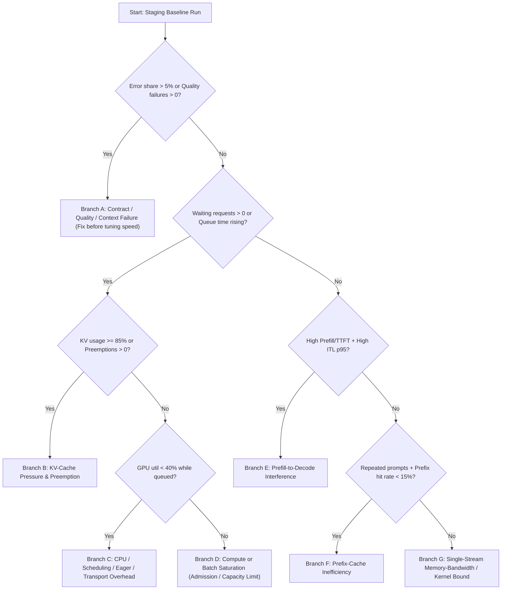

# Enterprise vLLM Optimization Playbook & Diagnostic Decision Tree

> **Scope & Honesty Boundary:**  
> - **Our direct lab measurements** come from controlled single-GPU RTX 4070 12 GB experiments (Qwen3-8B Q4_K_M on vLLM 0.34.0 + experimental `vllm-gguf-plugin` 0.0.5, Inkling-2-Mini 26B on `llama.cpp` b12588, Forge Qwen3.5-9B on Ollama).  
> - **Enterprise multi-GPU sections** (A100/H100/H200/B200, TP/EP/DP, disaggregated serving) synthesize vendor hardware specs, vLLM 0.34.0 documentation, and clearly attributed independent open-source research (e.g., Sybil Solutions). **We do not claim to have benchmarked H100/H200/B200 clusters ourselves.**

---

## 1. Diagnostic Decision Tree

Start every investigation from **client-visible goodput** (correct, on-time transactions/s under per-family SLOs), then narrow down using server Prometheus metrics and GPU telemetry:

---

## 2. Bottleneck-by-Bottleneck Diagnostic Reference

### Bottleneck 1: Request Queue Saturation
- **Symptoms:** `vllm:num_requests_waiting > 0`, rising `request_queue_time_seconds` and client TTFT p95, flat goodput as offered RPS increases.
- **Required Measurements:** Client offered RPS vs goodput, client TTFT p50/p95, `num_requests_waiting`, `num_requests_running`, `kv_cache_usage_perc`.
- **Relevant vLLM Components:** V1 scheduler admission (`scheduler.py`), `--max-num-seqs`, `--max-num-batched-tokens`, upstream load balancer.
- **How to Confirm Cause:** Replay fixed arrival rates bracketing the exact queue-onset RPS on an **isolated single replica** (eliminating noisy-neighbor traffic).
- **Configuration Levers:** Raise `--max-num-seqs` (only if KV headroom exists), tune `--max-num-batched-tokens`, or scale replicas horizontally (DP).
- **Risks & Trade-offs:** Admitting more concurrent sequences increases per-step decode latency (ITL) and can push KV occupancy into preemption.
- **Validation & Rollback:** `A-B-A` control bracket checking per-family TTFT + ITL + goodput; revert launch flags immediately if p95 ITL regresses.

### Bottleneck 2: KV-Cache Pressure & Preemption / Recomputation
- **Symptoms:** `kv_cache_usage_perc >= 0.85–0.95`, positive `num_preemptions_total` deltas on the same label series, sudden multi-second spikes in E2E/ITL latency.
- **Required Measurements:** Same-series `kv_cache_usage_perc` + `num_preemptions_total`, startup allocated KV blocks, prompt+output length distribution.
- **Relevant vLLM Components:** PagedAttention KV block manager, `--gpu-memory-utilization`, `--max-model-len`, `--kv-cache-dtype`.
- **How to Confirm Cause:** Lower `--max-model-len` to actual workload ceiling or cap concurrency on a dedicated replica and verify preemptions drop to zero alongside tail latency recovery.
- **Configuration Levers:**
  1. Right-size `--max-model-len` (do not reserve 128K if workload p99 is 8K).
  2. Raise `--gpu-memory-utilization` carefully (e.g., `0.85 → 0.90` on dedicated datacenter GPUs; keep desktop/shared margins conservative).
  3. Enable FP8 KV cache (`--kv-cache-dtype fp8`) on Ada/Hopper/Blackwell where supported.
  4. Move to higher-VRAM GPUs (e.g., H100 80 GB → H200 141 GB) or add TP if model weights starve KV.
- **Risks & Trade-offs:** Aggressive memory utilization risks startup/runtime OOM; FP8 KV can subtly degrade long-context needle retrieval or strict tool calling.
- **Validation & Rollback:** Must pass 85%-context retrieval and counterfactual tool-call checks before promotion; keep previous container/flag manifest for instant rollback.

### Bottleneck 3: Prefill-to-Decode Interference
- **Symptoms:** Long prompts cause spikes in `inter_token_latency_seconds` / `tpot_seconds` for concurrent short chat requests; `request_prefill_time_seconds` p95 >= 0.5s coincides with ITL p95 >= 0.1s.
- **Required Measurements:** Per-family TTFT and ITL under mixed short+long load vs a short-only negative control; `request_prefill_time_seconds` and `inter_token_latency_seconds` histograms.
- **Relevant vLLM Components:** Chunked prefill scheduler, `--max-num-batched-tokens`.
- **How to Confirm Cause:** Run a short-only control at identical decode concurrency; if ITL drops dramatically without long prompts, prefill interference is confirmed.
- **Configuration Levers:** Enable chunked prefill and bracket `--max-num-batched-tokens` (e.g., `512`, `1024`, `2048`, `4096`); at enterprise scale, evaluate separating long-context routes or prefill/decode disaggregation.
- **Risks & Trade-offs:** Too-small token budgets hurt aggregate throughput and long-prompt TTFT (directly observed in our RTX 4070 `batch_budget=512` bracket where c4 throughput dropped from `98.36` to `90.71 tok/s`).
- **Validation & Rollback:** Evaluate *both* short-chat ITL p95 and long-context TTFT p95 in an `A-B-A` bracket; roll back if combined goodput drops.

### Bottleneck 4: Prefix-Cache Inefficiency
- **Symptoms:** High `prefix_cache_queries_total` with `< 15%` `prefix_cache_hits_total` despite repeated system prompts, tool schemas, or shared RAG contexts; persistently high TTFT on repeated turns.
- **Required Measurements:** Paired `prefix_cache_hits_total` / `prefix_cache_queries_total` (same label series), matched vs skipped scrape intervals, and a 3-arm cold/warm/early-change prefix probe.
- **Relevant vLLM Components:** Automatic Prefix Caching (`--enable-prefix-caching`), chat template renderer, multi-replica router.
- **How to Confirm Cause:** Run our 3-arm prefix triplet (cold / warm identical / early-token-changed negative control). Our RTX 4070 probe confirmed ~22× TTFT drop (`2.77s → 0.125s`) on hits and full revert (`2.77s`) on early edits.
- **Configuration Levers:** Move all static system instructions, tool definitions, and shared documents to the exact start of prompts; enable `--enable-prefix-caching`; add prefix-aware routing across DP replicas.
- **Risks & Trade-offs:** Prefix-aware routing can create hot-replica imbalance if one tenant/prefix dominates traffic; high KV pressure evicts cached blocks prematurely.
- **Validation & Rollback:** Verify tenant isolation (never share untrusted private prefixes across tenants) and measure hit rate + TTFT under realistic multi-tenant concurrency.

### Bottleneck 5: CPU, Scheduling & Launch Overhead
- **Symptoms:** Requests queue (`waiting > 0`) or single-stream decode sits far below the GPU memory-bandwidth proxy while sampled GPU utilization stays low (`< 40%`).
- **Required Measurements:** Client TTFT/decode tok/s vs bandwidth proxy, `nvidia-smi` GPU utilization, host CPU core utilization, PyTorch/Nsight Systems timeline.
- **Relevant vLLM Components:** CUDA graphs vs `--enforce-eager`, async frontend IPC, Python tokenizer/detokenizer, output processor.
- **How to Confirm Cause:** Capture a short host+device trace (Nsight Systems / PyTorch profiler) showing large host gaps between GPU kernels.
- **Configuration Levers:** Disable `--enforce-eager` and enable CUDA graphs (sizing capture shapes to real batch sizes), ensure fast Rust tokenizers, avoid CPU oversubscription/throttling in containers, verify pinned host memory.
- **Risks & Trade-offs:** CUDA graph capture consumes extra VRAM and reduces KV pool size (which caused OOM on our 12 GB RTX 4070 at 0.67 budget).
- **Validation & Rollback:** Confirm startup memory headroom + steady-state KV margin before promoting graph-enabled config.

### Bottleneck 6: Memory-Bandwidth-Bound Decode (Single-Stream / Low-Batch)
- **Symptoms:** GPU utilization high, zero queue, low KV pressure, single-stream decode tracks `effective_VRAM_bandwidth / active_weight_bytes`.
- **Required Measurements:** Single-stream decode tok/s, active weight size, GPU memory bandwidth, quantization kernel path.
- **Relevant vLLM Components:** Weight quantization kernels (FP8, AWQ, GPTQ, Marlin), speculative decoding (MTP / draft models / N-gram), MoE placement (for hybrid offload).
- **How to Confirm Cause:** Compare measured decode against the hardware bandwidth proxy; test a supported lower-bit fused kernel or `k=1` speculative decoding at `c=1`.
- **Configuration Levers:**
  - Use hardware-native fused quantization (FP8 on H100/H200/B200/Ada, AWQ-Marlin for 4-bit) rather than unfused/experimental loaders.
  - Test speculative decoding (`k=1` first!) on code/structured workloads — *always* re-testing at target concurrency (our Forge Qwen3.5-9B study showed +23.5% on structured Python at `c=1` but regression at `c=2`).
  - Independent published research by Sybil Solutions (unaffiliated, not reproduced by us) similarly reports large stack- and kernel-specific wins (+44% RTX 3090 MTP, 2.1×–3.6× Arc, 4× H200 NVL) when matching engine/kernels to hardware.
- **Risks & Trade-offs:** Quantization can degrade coding/tool accuracy; speculation adds VRAM and can regress under concurrency.
- **Validation & Rollback:** Mandatory quality + tool-call + concurrency bracket before shipping; roll back on any accuracy or multi-stream regression.

### Bottleneck 7: Quality, Context & Contract Failures
- **Symptoms:** High raw tok/s, yet `quality_failures > 0`, HTTP 400 context-limit errors, truncated outputs, or malformed tool calls reduce qualified goodput.
- **Required Measurements:** Per-family error taxonomy, `quality_failures`, finish reasons (`length` vs `stop` vs `tool_calls`), verified `max_model_len`.
- **Relevant vLLM Components:** `--max-model-len`, `--tool-call-parser`, `--chat-template`, reasoning/thinking parser, quantization precision.
- **How to Confirm Cause:** Replay failing task families at `c=1` with verified context and parser flags.
- **Configuration Levers:** Fix `--max-model-len` and `--tool-call-parser` first; roll back aggressive quantization if quality fails.
- **Risks & Trade-offs:** Larger context or higher precision reduces concurrent capacity — treat correctness as a hard gate, never a soft trade-off.

---

## 3. Enterprise Multi-GPU & Topology Guidance *(Design Inputs — Verify on Customer Hardware)*

- **A100 (40/80 GB, PCIe vs SXM4):** Verify PCIe vs SXM before enabling TP; PCIe TP can regress decode latency at small batch sizes compared to single-GPU quantized DP replicas. ([NVIDIA A100 Datasheet](https://www.nvidia.com/content/dam/en-zz/Solutions/Data-Center/a100/pdf/nvidia-a100-datasheet.pdf))
- **HGX H100 / H200 / B200:** H200's 141 GB HBM3e often removes TP requirements or dramatically expands KV capacity without changing kernels. B200 unlocks FP4/FP8 paths when the exact vLLM + CUDA + driver stack supports them. ([NVIDIA HGX Comparison](https://docs.nvidia.com/enterprise-reference-architectures/hgx-ai-factory-h100-h200-b200/latest/components.html))
- **Scaling Order of Preference:**
  1. Fit on 1 GPU with clean fused quantization + DP replicas (plus prefix-aware routing if prefixes repeat).
  2. Add TP only within an NVLink domain when weights/KV don't fit or single-stream latency demands it.
  3. Consider EP for large sparse MoEs only after measuring expert skew and all-to-all interconnect overhead.
  4. Consider Prefill/Decode disaggregation only when mixed-load interference cannot be solved by chunked prefill and RDMA/NVLink KV transfer is verified.

---

## 4. Production Promotion & Rollback Discipline

1. **Pre-register pass criteria** (per-family TTFT, ITL, E2E, correctness, tool calls, error cap) before running candidate arms.
2. **Run `A-B-A` interleaved brackets** (control → candidate → repeated control) to catch thermal drift, noisy neighbors, or warmup artifacts.
3. **Require statistical sufficiency** (`>= 20` offered per family for gates; `>= 40` completed samples before reporting p95).
4. **Canary & Rollback:** Deploy winning config to 1 canary replica first with identical SLO alerts; keep previous container digest + CLI flags ready for instant one-command rollback.
5. **Honest Economics:** Report qualified goodput first; convert to dollars using $1 - 1/g$ **only** against customer-confirmed reducible GPU spend after accounting for redundancy and failover.
