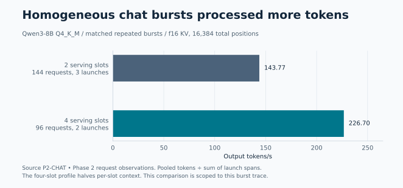
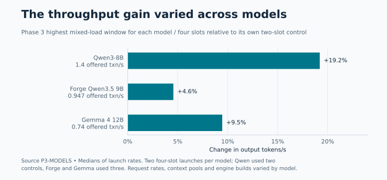
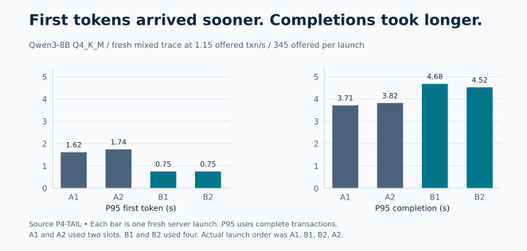
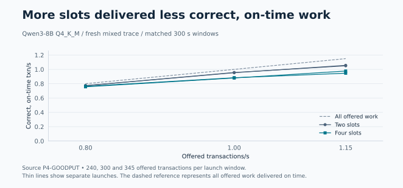
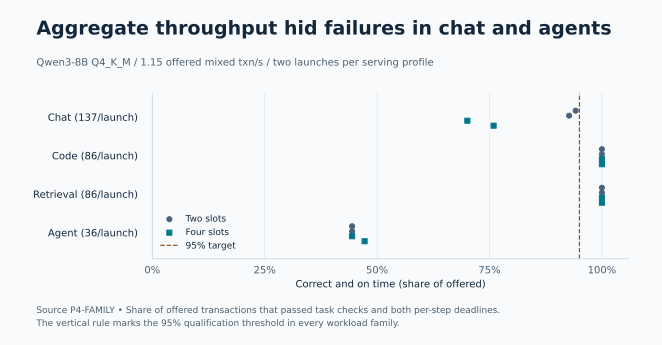

# More tokens, less useful work

*An RTX 4070 inference study across three models, sustained load and a fresh workload replication.*

## Abstract

We tuned a local CUDA inference server, changed how many requests it could admit, then replayed a new workload to see which gains survived. On Qwen3-8B, four serving slots increased output throughput from **143.77 to 226.70 tokens/s** in homogeneous chat bursts. Under a fresh mixed workload at **1.15 offered transactions/s**, the same slot change cut p95 time to first token from **1.616–1.741 s to 0.753 s**, while correct, on-time goodput fell from **1.050–1.057 to 0.947–0.977 transactions/s**. Neither profile qualified under the strict per-workload service objective. More slots also divided the fixed KV cache into smaller per-request windows. The experiments show why a serving profile should be judged against a traffic mix, a context requirement and a definition of useful completion. [P2-CHAT](../publication/CLAIMS_LEDGER.md#p2-chat) · [P4-TAIL](../publication/CLAIMS_LEDGER.md#p4-tail) · [P4-GOODPUT](../publication/CLAIMS_LEDGER.md#p4-goodput)

## Hypotheses

For a short single stream, quantized decoding repeatedly applies the model weights to one new token. When several sequences are ready to decode, batching can amortize some of that weight movement. Extra serving slots may also shorten the wait before a request starts. A mixed service brings a competing effect. Long prompts introduce prefill work into the same scheduler, and each admitted sequence can receive less decode time. These mechanisms predict that first-token and completion latency can move in different directions.

Flash Attention reduces the need to materialize attention intermediates. Prefix caching avoids evaluating tokens whose KV state can be reused. Both predict gains under suitable workloads. Their value depends on the comparison baseline and the frequency of reusable prefixes. Speculation can amortize target-model work when a draft supplies useful tokens at sufficiently low cost. A higher draft acceptance share alone does not establish a useful serving gain.

## Hardware and serving contracts

The test machine ran Windows 11 Home build 26300 on an AMD Ryzen 7 7800X3D with 64 GB nominal RAM and an NVIDIA GeForce RTX 4070 with 12 GB nominal VRAM. WDDM board telemetry includes desktop GPU activity. The main Qwen and Gemma tests used the llama.cpp CUDA build **b12427**, source commit `1719dbb0ee7bdaf56de083079d3613bb670160a5`. The Forge Ollama text export required a separate draft loader at `e4ee2d21a8ceae24aecdc7c3a229a48ad3b34ee5`. The archived comparison for each model held the build and weights fixed. [ENV](../publication/CLAIMS_LEDGER.md#env)

| Model | Checkpoint format | Total context for slot comparison | Per slot, two → four |
| --- | --- | ---: | ---: |
| Qwen3-8B | Q4_K_M GGUF | 16,384 | 8,192 → 4,096 |
| Forge Qwen3.5 9B | Q4_K_M GGUF text export | 8,192 | 4,096 → 2,048 |
| Gemma 4 12B IT QAT | Q4_0 GGUF text export | 8,192 | 4,096 → 2,048 |

The slot comparisons use f16 KV. The smaller window belongs to the serving contract even when the matched prompts fit. The separately tested four-slot long-context q8 KV recipe changes cache precision and allocation. Its retrieval checks cover the tested task. [ENV](../publication/CLAIMS_LEDGER.md#env) · [P2-METHOD](../publication/CLAIMS_LEDGER.md#p2-method)

## Measurement design

Prefill processes the input sequence. Decode generates new tokens. The cold prefill probe disables reuse and divides tokenizer-confirmed prompt tokens by client time to first token (TTFT). That client rate includes transport, admission and the first emission. The server-reported evaluation timing is a separate field. Decode and output counts use server usage and timing counters where supported. An SSE event may carry fewer or more than one visible token.

TTFT measures the wait for the first visible generation event, or the first tool-call delta for a tool request in the product. Completion latency includes generation through the end of the response or transaction. Phase 2 pools successful output tokens over the sum of observed launch spans. The open-loop studies divide output and correct on-time work by the scheduled arrival window and keep late, rejected and incorrect work in the offered denominator. Goodput is the number of scoped-correct transactions meeting the latency gates per second. Per-family qualification applies the gates separately to chat, coding, document retrieval and agents. Historical agent deadlines were evaluated per step, while the product also supports an end-to-end transaction measure. [Evidence inventory](../publication/EVIDENCE_INVENTORY.md)

Leading and trailing controls bracketed candidate launches. The open-loop comparisons use order A1, B1, B2, A2 with fresh server launches. The plotted ranges and points are descriptive across launches on one host. Requests within a launch share queues and cannot serve as independent machine replications. Tail statistics use completed transactions. Failed and rejected traffic is accounted for separately in qualification.

## Phase 1 · Establishing the right baseline

The original control explicitly disabled Flash Attention. With fused attention enabled and the physical microbatch raised from **256 to 512**, the selected Qwen recipe moved isolated decode from **81.03 to 84.11 tokens/s** and cold **7,168-token** client prefill from **2,291 to 4,207 tokens/s**. The decode comparison uses six observations per launch and cold prefill uses three. The effect combines two changes and the control deliberately leaves useful acceleration off. [P1-TUNING](../publication/CLAIMS_LEDGER.md#p1-tuning)

The follow-up used a context-normalized baseline with automatic Flash Attention. Startup records show it enabled the feature. It delivered **4,197–4,209 tokens/s** for the same-size cold prefill probe, compared with **4,200** for the explicit Phase 1 recipe in the follow-up. The large initial prefill delta therefore describes a feature-disabled control. The normal-default follow-up better represents the starting point an operator would encounter on this build. [P2-DEFAULT](../publication/CLAIMS_LEDGER.md#p2-default)

## Phase 2 · Slots, batching and queueing

An Nsight Systems capture attributed **93.3%** of summed short-decode kernel time to quantized GEMV and **75.4%** of summed cold-prefill kernel time to quantized GEMM. The profiler identified CUDA graph activity and a host sampling path. Access to hardware counters was denied, so achieved memory bandwidth and occupancy were unmeasured. The trace helps select an experiment. It does not quantify an available speedup and its profiled rates were excluded from comparisons. [P2-PROFILE](../publication/CLAIMS_LEDGER.md#p2-profile)

The most favorable result was the homogeneous chat trace. At fixed weights, template, sampling and total context, two slots yielded **143.77 output tokens/s** and four yielded **226.70** (**+57.7%**). The result pools three control launches and two candidate launches. Each profile replayed the same short-burst deck per launch. The production-style two-slot profile is the reference, and the per-request context window shrinks on four slots. [P2-CHAT](../publication/CLAIMS_LEDGER.md#p2-chat)

A mixed trace with complete-output code fixtures told a different story. Four slots lifted scoped goodput from **1.155 to 1.418 requests/s**, even as output throughput dipped from **92.24 to 90.55 tokens/s**. The context-normalized default yielded **1.160 requests/s** in its single matched launch. Phase 2 measured the dependent agent steps as requests and applied their own deadlines. Early capped code responses are excluded from these complete-output claims. [P2-MIX](../publication/CLAIMS_LEDGER.md#p2-mix)

A repeated long prompt retained nearly all of its KV state in the warm probe. Disabling the host prompt cache reduced reuse on the early synthetic mix, whose code examples could hit their output cap. Draft-free n-gram speculation improved the repetitive V3 workload under matched controls. The learned draft consumed more VRAM and raised the first-token tail despite accepting many proposals. The one-off Phase 3 n-gram screens did not establish usable deadline gains on the transfer models. The evidence favors testing cache locality and speculative verification cost on the intended workload before enabling either as a serving policy. [P2-METHOD](../publication/CLAIMS_LEDGER.md#p2-method) · [P3-MODELS](../publication/CLAIMS_LEDGER.md#p3-models)

## Phase 3 · Transfer across models

All three models generated more output tokens on four slots in their highest matched mixed-load window. The size of the effect varied. Relative changes use the median of launch throughput within each model. The table gives the offered rate and candidate transaction count so the rows are interpretable without comparing their raw speed as a cross-model ranking. [P3-MODELS](../publication/CLAIMS_LEDGER.md#p3-models)

| Model | Offered txn/s | Two-slot tok/s | Four-slot tok/s | Relative change | Four-slot valid/offered |
| --- | ---: | ---: | ---: | ---: | ---: |
| Qwen3-8B | 1.400 | 114.35 | 136.32 | +19.2% | 1,680/1,680 |
| Forge Qwen3.5 9B | 0.947 | 95.37 | 99.72 | +4.6% | 284/284 |
| Gemma 4 12B IT QAT | 0.740 | 71.33 | 78.07 | +9.5% | 222/222 |

Qwen used two controls and two candidates in **600-second** windows. Forge and Gemma used three controls and two candidates in **150-second** windows and ran separate **45-minute** transfer studies. Forge and Gemma both missed the aggregate **95%** on-time target on their four-slot high-load windows. Validity alone omits lateness. Offered load, working context, workload composition and engine build varied across models. This design cannot attribute the gain differences to model architecture or quantization. [P3-MODELS](../publication/CLAIMS_LEDGER.md#p3-models)

## Phase 3 · Sustained load and recovery

The retained Qwen study covers **180 scheduled minutes in segments**. Windows slept during the original A2. That window reported about **10,031 elapsed wall-clock seconds** for a planned **1,800-second** block. A fresh A2 and the remaining stages ran after recovery. The recount excludes the sleep-affected window and validates the retained layout against matched plans and wall clocks. This establishes the recorded segment behavior. Uninterrupted endurance remains unverified. [P3-RUN](../publication/CLAIMS_LEDGER.md#p3-run)

Peak sampled board temperature was **69.7 °C** and peak device residency **8,086 MiB**. The retained stages include **639** explicit admission-limit outcomes. In the recovery block, **1,302/1,320** offered transactions met the deadlines at **1.1 offered transactions/s**, in the same server process used for the preceding overload. Under the strict per-family gate, both slot profiles qualified up to **0.8 offered transactions/s** on the tested grid. Under an aggregate gate, four slots reached **1.1** while two reached **0.8**. Cross-session desktop activity limits fine comparisons of board metrics. [P3-RUN](../publication/CLAIMS_LEDGER.md#p3-run) · [P3-SLO](../publication/CLAIMS_LEDGER.md#p3-slo)

## Phase 4 · A fresh workload changes the answer

The local replication replaced the earlier synthetic deck with varied nuisance text, unique receipts, checkable code and dependent agent turns. Prefix-cache hit share fell to around **0.9–1.0%**. The test kept Qwen weights, the f16 KV pool, tokenizer-verified workload inputs and sampling fixed between arms. It ran **60 scheduled minutes**, split across the four launches, and offered **3,540 transactions**. The highest-rate window offered **345 transactions per launch**. Changes in workload composition and locality are jointly present, so this experiment cannot isolate the effect of cache reuse. [P4-DESIGN](../publication/CLAIMS_LEDGER.md#p4-design)

At the highest tested offered rate, **1.15 transactions/s**, p95 TTFT fell from **1.616–1.741 s** to **0.753 s** on both candidate launches, while p95 completion rose from **3.714–3.820 s** to **4.523–4.678 s**. Output throughput stayed around **104 tokens/s** across all four launches. Correct on-time goodput fell from **1.050–1.057** to **0.947–0.977 transactions/s**. The same direction holds under a sensitivity check that rejects capped streams even when the receipt is present. Correctness failures among dependent agents and deadline misses among chat made aggregate throughput a poor proxy for service. Neither slot profile qualified at any tested load under the strict **95% per-family** contract. [P4-TAIL](../publication/CLAIMS_LEDGER.md#p4-tail) · [P4-GOODPUT](../publication/CLAIMS_LEDGER.md#p4-goodput) · [P4-FAMILY](../publication/CLAIMS_LEDGER.md#p4-family)

This is an independent workload and restart sequence run on the same machine by the same project. It provides a useful counter-test against the earlier synthetic traces. An external lab or production trace would answer a different replication question.

## From the experiment to Inference Audit

The CLI makes the experimental contract explicit. It records scheduled and observed traffic, usage, task checks, timeouts, telemetry and local integrity checks. Reports preserve per-family results and can be regenerated without contacting a model. Conditional cost scenarios require declared assumptions and measured capacity inside the chosen contract. A faster GPU-second can cost less for token-metered work, while a provisioned worker can cost the same if its count and running hours remain fixed.

The [Qwen demonstration](../../public/reports/qwen3-8b-audit.html) replays the earlier product acceptance sweep through the 0.2.1 renderer. A separate [Gemma report](../../public/reports/gemma4-12b-audit.html) shows a shorter compatibility capture. Some of these probes change the number of client workers against a fixed server, which is different from changing serving slots. These audits validate the measurement workflow on the stated captures. The controlled CUDA shutdown path remains experimental and requires native validation. [DEMO](../publication/CLAIMS_LEDGER.md#demo)

## Reproduction and limitations

Use the [claims ledger](../publication/CLAIMS_LEDGER.md) to map each result to a source archive and formula. The [public measurement projection](../../public/evidence/measurements.json) contains selected numeric observations and enough per-launch data to recompute the headline comparisons and figures. The original requests, responses, process logs and machine identifiers stay in the local archive. [Publication reproduction](../publication/REPRODUCE.md) separates figure regeneration, archived raw replay and a new authorized staging audit.

The workloads are synthetic, with narrow answer checks and engine-specific cache behavior. The evidence covers one consumer GPU, a particular Windows stack and pinned model/runtime builds. The retained local SHA-256 seals check files against their index and can be recomputed by a writer. Offline verification checks stored observations and consistency, including multi-step structure. It cannot re-evaluate withheld answers. These measurements leave production traffic, long-run reliability, native CUDA shutdown for the current product, and fleet savings unverified.

## Conclusion

Four slots improved homogeneous chat throughput and reduced first-token tails on the fresh mix. The fresh mix also completed later and delivered less correct work on time. If a deployment needs the larger context window or the stricter workload-family target, those constraints can outweigh the apparent win. Define the customer-visible completion and capacity criteria first, then replay a representative workload against matched controls before selecting a serving profile.
