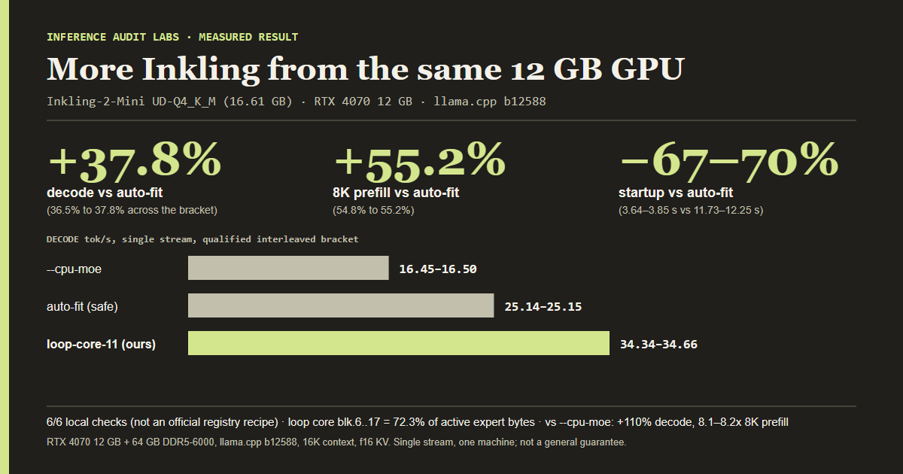

# Inkling-2-Mini on a 12 GB GPU: loop-aware tensor placement



## Executive summary

Inkling-2-Mini (Unsloth `UD-Q4_K_M`, 16.61 GB, 26.4B parameters) is larger than the 12 GB of VRAM on an RTX 4070, so part of it must live in host RAM. Which part matters a great deal. The model is a **looped mixture-of-experts**: twelve of its 24 physical blocks (`blk.6..17`) run three times per generated token. Placing those blocks on the GPU first, instead of the default or sequential choices, produced the following in a qualified, interleaved comparison on one RTX 4070 12 GB with 64 GB DDR5 and Unsloth llama.cpp b12588.

| Metric (single stream, 16K context) | `--cpu-moe` | auto-fit (safe) | **Loop-aware (`loop-core-11-nommap-ub512`)** | Gain vs auto-fit | Gain vs `--cpu-moe` |
| --- | ---: | ---: | ---: | ---: | ---: |
| Decode, tok/s | 16.45–16.50 | 25.14–25.15 | **34.34–34.66** | **+36.5% to +37.8%** | +108.2% to +110.1% |
| 8K prefill, tok/s | 97.03–97.96 | 496.09–514.49 | **796.29–798.54** | **+54.8% to +55.2%** | 8.1–8.2× |
| Startup (ready), s | 7.51–7.76 | 11.73–12.25 | **3.64–3.85** | **−67% to −70%** | not applicable |

The configuration also passed **all 6 of 6** local acceptance checks (modeled on the `local-ai-registry` gate set) and a six-request stability soak. **This is not an officially accepted `local-ai-registry` recipe.** Vision, broader quality benchmarks, production concurrency and external customer infrastructure remain unverified. The result is specific to this machine, this build, one stream and a 16,384-token context—a measured configuration trade-off, not a general guarantee or a verified cost saving.

Everything on this page is recomputable from [`public/evidence/inkling-hybrid.json`](../../public/evidence/inkling-hybrid.json). Claim wording and limits are in the [claims ledger](../publication/CLAIMS_LEDGER.md#p8-inkling).

## Test bed

| Item | Value |
| --- | --- |
| Model | `hf.co/unsloth/Inkling-2-Mini-GGUF:UD-Q4_K_M`, 16,610,543,328 bytes, 734 tensors, SHA-256 `f90c5a4df44d335ac9f9eea2a15c31d6c5a377b1b3cd9ff7fc2cf123f3cdf7e1` |
| Architecture | `inkling2`, text path only (`--no-mmproj`, the 318M CLIP projector is not loaded) |
| GPU | NVIDIA GeForce RTX 4070 12 GB (12,282 MiB), driver 621.24, 431 GB/s measured device copy |
| CPU / RAM | AMD Ryzen 7 7800X3D (8C/16T), 64 GB DDR5-6000 |
| Engine | Unsloth portable llama.cpp, CUDA 13.3, build b12588, commit `883286076efe5b85fddb31d9cc7035a6b698ba9b` |
| Serving | One slot, 16,384 context, f16 KV (lossless), reasoning effort low |

## The physics: why a looped MoE rewards loop-aware placement

Decode is bandwidth-bound. Anything resident on the CPU is read from DDR5 on every token, and CPU quantized expert math is far slower than the GPU. So the goal is to move the *most frequently read bytes per gibibyte of VRAM* onto the GPU.

Inkling has 48 logical layers backed by 24 physical blocks:

| Section | Blocks | Passes per token | Routed experts (physical) | Active expert bytes per token |
| --- | --- | ---: | ---: | ---: |
| Prelude | `blk.0..5` | 1 | 3.440 GB | 215.0 MB |
| **Looped core** | **`blk.6..17`** | **3** | **6.880 GB** | **1,289.9 MB (72.3%)** |
| Postlude | `blk.18..23` | 1 | 4.459 GB | 278.7 MB |
| All routed experts (top-8 of 128) | 24 blocks | 48 logical | 14.779 GB | 1,783.6 MB |

Non-expert weights add 1.82 GB physical and about 2.28 GB of reads per token (dense layers run 48 times, plus the 0.49 GB output head). Roughly 40 of the 48 logical layers use 1,024-token sliding-window attention, so the f16 KV cache is only about 705 MB at 16K context.

Because the core runs three times per token, one GB of core experts on the GPU removes **187.5 MB per token** of CPU memory traffic, against **62.5 MB** for one GB of prelude or postlude experts. That is a **3.0× VRAM return per GiB**. Sequential offload strategies (`--n-cpu-moe`, naive layer splits) prioritise the last physical layers, which are the once-executed postlude, and leave the thrice-executed core on the CPU. A byte-accounting model written before the runs predicted this ordering of placements, and the measurements below confirmed it.

## Placement screen

Single run per case, 1K prefill and median decode, used to choose a placement to qualify. `fit-default` hit the VRAM safety stop (peak 11,055 MiB, 956 MiB free) and produced no result.

| Case | What is on the GPU | Decode tok/s | Peak VRAM, MiB | Min free, MiB |
| --- | --- | ---: | ---: | ---: |
| `cpu-moe` | non-experts only | 16.69 | 4,760 | 7,251 |
| `seq-postlude-6` | last 6 expert blocks (1× each) | 19.25 | 8,242 | 3,769 |
| `moe-cache-6g` | 6 GB expert cache | 22.47 | 10,234 | 1,777 |
| `fit-safe` (auto-fit) | engine-chosen split | 24.85 | 9,658 | 2,353 |
| `loop-core-10` | 10 core blocks | 31.98 | 9,576 | 2,435 |
| `loop-core-11` | 11 core blocks | 34.12 | 10,134 | 1,877 |
| `loop-core-12` | all 12 core blocks | 36.56 | 10,684 | 1,327 |

Six GB of the sequential postlude buys +2.6 tok/s over `cpu-moe`. Ten core blocks, using about 1.2 GB more VRAM than that, buy +15.3 tok/s.

## Secondary levers

Measured on the 12-block base placement unless noted.

| Lever | Result | Decision |
| --- | --- | --- |
| `--load-mode none` | Startup 9.11 s → 3.62 s, decode 36.45 → 36.94 tok/s | **Adopted** (startup 11.93 s on auto-fit versus 3.62 s) |
| `-ub 256` | 1K prefill 219 → 477 tok/s, decode 36.68 | Strong prefill lever, but costs about 40 MiB more VRAM |
| `-ub 512` | Part of the winning recipe; see the qualified table for 8K prefill | **Adopted** for the winner |
| `-t 6`, `-t 12` | 36.30 and 35.40 tok/s versus 36.45 for `-t 8` | **Rejected** (slower) |
| q8_0 KV cache | 36.39 tok/s, no speed gain | **Rejected** (adds quantization risk for no gain) |

## Qualified interleaved comparison

Controls and candidate alternated (`cpu-moe`, auto-fit, candidate) with a repeat, six decode requests per run and prefill at 512, 2,048, 4,096 and 8,192 tokens with a needle check. All 8 prefill needle checks per arm passed. The winner is `loop-core-11-nommap-ub512`, chosen over 12 blocks for VRAM headroom.

| Arm | Decode tok/s | 8K prefill tok/s | Ready, s | Peak VRAM, MiB | Min free, MiB |
| --- | ---: | ---: | ---: | ---: | ---: |
| `cpu-moe` ×2 | 16.45, 16.50 | 97.03, 97.96 | 7.76, 7.51 | 4,131 | 7,880 |
| auto-fit ×2 | 25.14, 25.15 | 514.49, 496.09 | 11.73, 12.25 | 9,753 / 10,026 | 2,258 / 1,985 |
| **loop-core-11-nommap-ub512 ×2** | **34.34, 34.66** | **798.54, 796.29** | **3.85, 3.64** | 10,543 / 10,678 | 1,468 / 1,333 |

Gain ranges come from comparing each candidate run against its adjacent control. The candidate placed all non-expert weights (1.82 GB) plus 11 core expert blocks on CUDA0 (7,280.6 MiB model plus 240 MiB KV). The prelude, `blk.17` and the postlude experts (8,549.1 MiB) sat in pinned host RAM.

## Local acceptance checks: 6 of 6

Run locally using checks modeled on the `local-ai-registry` gate criteria on the winning configuration. Passing these local checks does **not** make this an officially accepted `local-ai-registry` recipe (which requires a pinned clean Linux/container build and upstream review).

| Check | Result |
| --- | --- |
| Load | Pass |
| Chat | Pass (113 tokens, 33.93 tok/s, finish `stop`) |
| Reasoning | Pass (296 reasoning characters, correct answer, 34.13 tok/s) |
| Tools | Pass, 2/2 cases including the counterfactual, strict format on both |
| Context at 85% | Pass: 13,926-token prompt, needle `CTX85-7749-VQ` found, 812.75 tok/s prefill, 17.33 s TTFT |
| Speed, 30 s uncapped | Pass: 1,010 tokens in 30.01 s = **33.62 tok/s** |

A six-request soak ran cleanly (first 33.65, last 34.11, median 34.20 tok/s, min 33.65 tok/s), with no degradation.

## Explicit VRAM boundary: the 12-core desktop limit

All 12 core blocks with `-ub 256` and no mmap decoded at **37.00 tok/s** (36.997 median) with 8K prefill of 682.65 tok/s. It also drove the board to **11,057 MiB used with only 954 MiB free** and tripped the safety stop. On a desktop that also drives a display, this leaves too little headroom, so it is documented as the boundary and not recommended. Eleven blocks gave up about 2.3 to 2.7 tok/s of decode in return for 1,333–1,468 MiB of free VRAM. A headless GPU or a larger card could reasonably qualify 12 blocks separately.

## DSpark speculative drafting: absent, deferred

The GGUF contains **0 embedded DSpark/MTP tensors**, and no local drafter artifact is installed. Speculative decoding was therefore deferred without downloading any new weights. No speculative result is claimed.

## Reproduce

Substitute your own GGUF location for `<MODEL_GGUF>`. Use the same pinned build, and expect to adjust the block range if your free VRAM differs. The regular expression keeps experts for `blk.0..5` and `blk.17..23` in host RAM.

```powershell
llama-server -m <MODEL_GGUF> --jinja --no-mmproj -c 16384 -np 1 `
  --reasoning-effort low --fit off -ngl all `
  -ot "blk\.([0-5]|1[7-9]|2[0-3])\.ffn_.*_exps\.=CPU" `
  --load-mode none -fa on -b 512 -ub 512 -t 8 -tb 8
```

Verify placement in the startup log: roughly 7,280 MiB on `CUDA0`, 8,549 MiB in `CUDA_Host`, and 25/25 layers offloaded. Add `--host` and `--port` for your deployment. Source summaries are hashed in the evidence file (`inkling-screen-02`, `inkling-levers-01`, `inkling-qualify-01`, `inkling-qualify-02`).

## Limits

One machine, one session, one stream, 16,384 context, f16 KV, text only. This configuration is **not** an officially accepted `local-ai-registry` recipe. Vision (`--no-mmproj`), broader output-quality benchmarks, production concurrency, external customer infrastructure, and financial savings remain unverified. Throughput was measured, not hardware DRAM counters, which are unavailable under Windows WDDM. Server decode medians exclude HTTP overhead. The placement choice depends on free VRAM at run time. See the [economics model](../../public/economics.html) for conditional scenarios, and the [Forge MTP report](FORGE_MTP.md) for a separate engine-level lever.
